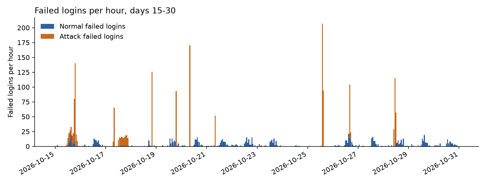
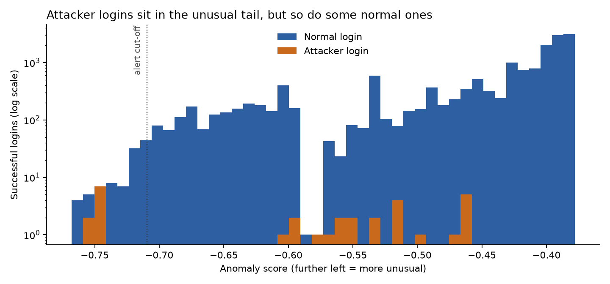

# Login Attack Detection

Finding five kinds of account attack in 30 days of login logs, using four SQL rules and one machine learning model. All 25 hidden attacks are caught. Getting there produces 118 alerts, and 84 of them are false, which turned out to be the more interesting result.

## Why I built this

I got into security this fall as a side hobby, specifically red teaming. I wanted to work the other side using tools I already know: SQL and Python. Login logs are a good place to start as the attacks are well documented and the data is simple. The hard part is determining an attacker from someone who forgot their password or is on a work trip.

## The data

`generate_logs.py` builds 33,131 login events for a made-up company with 400 staff. Days 1 to 14 are clean and are used to learn what normal looks like. Days 15 to 30 contain the attacks. The answer key is kept in a separate folder and the detection code never reads it.

The log has only what a real authentication log would have: time, username, source address, country, and success or failure.

| Attack | Incidents | What it looks like | MITRE ATT&CK |
|---|---:|---|---|
| Brute force | 6 | One address, one account, 40 to 200 fast failures | T1110.001 |
| Password spraying | 4 | One address, 80 to 200 accounts, one try each | T1110.003 |
| Slow credential stuffing | 2 | Over 50 rotating addresses, 150 accounts, spread over 10 hours | T1110.004 |
| Takeover from abroad | 8 | Correct password on the first try, from another country | T1078 |
| Admin account off hours | 5 | Correct password, same country, 2 to 4am, new address | T1078 |

I also added normal activity that looks suspicious: 12 people on work trips, 30 people who start using a new address, and 3 people who failed their own password ten or more times in a row (it happens to the best of us).

## Results
Incidents caught, by detector:

| Attack | Brute force rule | Spray rule | Impossible travel | Unknown source spike | Anomaly model | Any |
|---|---:|---:|---:|---:|---:|---:|
| Brute force | 6/6 | - | - | 1/6 | 2/6 | 6/6 |
| Password spraying | - | 4/4 | 2/4 | 4/4 | - | 4/4 |
| Slow credential stuffing | - | - | 1/2 | 2/2 | - | 2/2 |
| Takeover from abroad | - | - | 8/8 | - | - | 8/8 |
| Admin account off hours | - | - | - | - | 5/5 | 5/5 |

In 20 of the 25 incidents the attacker got into at least one account. All 20 were flagged.

Alert quality:

| Detector | Alerts | True | False | Precision |
|---|---:|---:|---:|---:|
| Brute force rule | 6 | 6 | 0 | 100% |
| Password spray rule | 4 | 4 | 0 | 100% |
| Unknown source spike | 5 | 5 | 0 | 100% |
| Impossible travel | 24 | 12 | 12 | 50% |
| Anomaly model | 79 | 7 | 72 | 9% |



## What I learned

**The loud attacks are easy.** Brute force and spraying stand out in the chart above. A simple threshold catches each one with no false alerts. The three people who forgot their passwords didn't trip the brute force rule as none of them reached 20 failures in 10 minutes.

**Slow credential stuffing hides from per-address rules.** No single address made more than 7 attempts over those 10 hours, so the first two rules saw nothing. What worked was grouping every address the company had never seen a successful login from, and counting how many different accounts they failed against each hour. In the clean period that number should almost always zero.

**Stolen passwords leave no failures at all.** The takeovers and the off-hours admin logins have no failed attempts. Impossible travel catches the foreign ones and it also flags people coming home from trips. Half its alerts are false, and every false one is a real employee on a real flight which a travel calendar or a VPN list would fix most of that.

**The machine learning model is the weakest detector.** It is the only thing that caught the off-hours admin logins, where the country is right and the password is right. But 72 of its 79 alerts are false. Most are people are just logging in from a different address at a slightly odd hour.



Looking at what it actually caught, a plain rule would probably do the same job with far fewer alerts: admin account, address never seen before, outside that user's usual hours. I think that is the honest conclusion but the model was useful for showing me which features matter. 

## How each detector works

1. **Brute force** (`sql/01_brute_force.sql`). A sliding 10-minute window using `COUNT(*) OVER (... RANGE BETWEEN 600 PRECEDING AND CURRENT ROW)`. Flags 20 or more failures for the same address and account.
2. **Password spraying** (`sql/02_password_spray.sql`). One address failing against 15 or more different accounts in an hour.
3. **Impossible travel** (`sql/03_impossible_travel.sql`). Uses `LAG` to compare each successful login with the same user's previous one and flags it if the distance between the two countries divided by the time gap is over 900 km/h.
4. **Unknown source spike** (`sql/04_unknown_source_spike.sql`). Hourly count of accounts with failures from never-seen addresses, compared with the baseline mean and variance.
5. **Anomaly model** (`src/anomaly.py`). An Isolation Forest on successful logins with six features, each measured against that user's own history: new address, new country, how rare the hour is for them, admin flag, how many accounts that address touched in the last day, and the user's failures in the last hour.

For the model I split the time so it never sees its own answers. Days 1 to 10 build each user's profile. Days 11 to 14 are scored against that profile to learn how unusual normal logins are and days 15 to 30 are the test.

## Limits

- The data is synthetic. I wrote the attacks and the detectors, so the thresholds fit better than they would on real logs.
- Country is the only location while real logs have city or coordinates, which would make impossible travel sharper and also noisier.
- There is no device or browser information, which is one of the strongest signals.
- The thresholds are fixed numbers and a team would probably tune them against its own alert volume.
- Source addresses come from ranges reserved for testing, so none of them point at a real host.

## Run it

```
python -m venv venv
source venv/bin/activate
pip install -r requirements.txt

python generate_logs.py      # optional, the data is already in the repo
python run_detections.py
pytest
```

## Files

```
generate_logs.py       builds the login events and the answer key (seeded)
run_detections.py      runs every detector and scores the results
sql/                   schema and the four detection rules
src/load_db.py         loads SQLite and builds the country distance table
src/anomaly.py         feature building and the Isolation Forest
data/                  events, users, country centre points
answer_key/            which events belong to which attack
outputs/               alerts, coverage tables, charts
tests/                 unit tests for the rules
```

## What I would do next

- Replace the model with the simple admin rule described above and compare the two directly.
- Score alerts by risk so one analyst queue can be sorted, instead of five separate lists.
- Join alerts for the same account within a day. A spray followed by a foreign login on one of the sprayed accounts is one story, not two alerts.

## Tools

SQL (SQLite window functions), Python (pandas, scikit-learn), matplotlib, pytest
